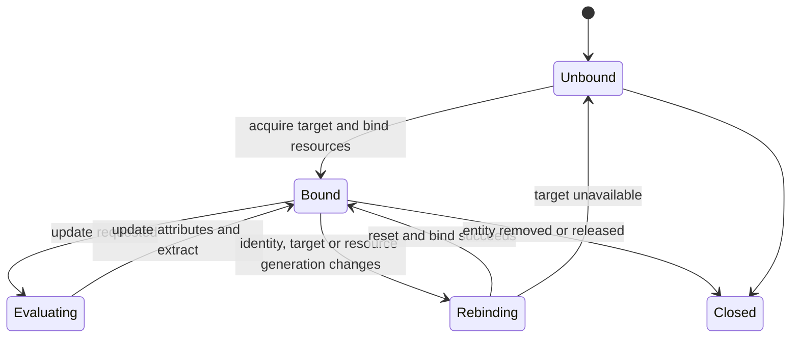

# `AnimatableEntity` 与帧状态

`AnimatableEntity` 是客户端 `Entity` 的动画生命周期根，不是网络 DTO，也不是 native model。它把共享模型资源绑定到一个 `entity`，串联输入、controller、entity 自己的 Molang 状态、processor 与渲染输出。

## 实体级所有权

| 状态 | 生命周期与用途 |
|---|---|
| 模型绑定与 lease | `EntityModelBinding` 指向当前 render target，并保证解析资源、烘焙几何和纹理在使用期间存活 |
| controller 集合与时间线 | 保存各 controller / player 的状态、播放进度、转换和上次逻辑时间 |
| `AnimationProcessor` | 保存骨骼 snapshot、active bone 与通道复位状态，并写入模型拥有的 `BoneAttribute` |
| Molang 状态 | 由 `AnimationProcessor` 持有的 `MolangMemory`（`v` scoped 变量与当前 roaming struct 引用、`t` 临时槽）以及 animation player 上的 defer 参数缓冲；这些状态都按 entity 隔离 |
| `Entity` 输入状态 | 跟踪 tick、移动、`Pose` 和网络投影，用于计算连续输入 |
| 输出槽 | 保存 canonical 或按 `RenderContext` 分区的 mutable `GeoModelState`；其 native 状态拥有 pose / normal 存储，Java 保存借用 view 和 locator 映射 |

模型 animation、controller、用户函数、事件 handler 与解析后的 AST 是 target 级只读资源；上表的可变状态按 entity 隔离。骨骼数组由[Processor](processor-and-bone-output.md)写入，输出槽与 view 借用由[帧执行](../rendering/frame-execution.md#输入输出与状态)定义。

## 绑定与切换

Model switch、Molang 求值（含 defer 排空）与 close 在同一 entity owner barrier 内串行；跨线程提交的表达式经 processor 的队列在下一帧汇合，GC 不充当逻辑关闭信号。

同一 render target 内的纹理或兼容变体可通过 `AnimatedGeoModel.setModelInplace(...)` 保留 controller、Molang 变量状态、roaming struct 引用、物理与时间线，并在等待既有任务后替换渲染资源。第一人称手臂只可显式共享主模型的 roaming struct，普通 entity 之间不共享 `v` 变量存储。模型身份、target 或资源代次改变时，先准备新资源，再在 entity owner barrier 内切换 current eligibility、丢弃旧状态（`MolangMemory` 的 scoped 变量、defer 缓冲与 roaming 引用），最后关闭旧 lease。已进入旧 barrier 的调用要么在资源仍 current 时完整结束，要么成为 stale/closed；效果在 `allowEmitting` 为真时已经立即作用于宿主，没有可丢弃的暂存提交或回滚点。是否保留必须由完整资源兼容性决定，不能只凭用户路径或短 hash 推断。

### 内置玩家模型变体的失效驱动

内置玩家模型（Steve/Alex）的宽/细手臂跟随玩家当前皮肤。宽/细由客户端皮肤模型名决定，服务端看不到，因此在客户端本地裁决：`PlayerAnimatableCapability` 在模型可用时把当前选择收敛到与皮肤一致的变体，不覆盖非内置选择。

判定不再逐帧轮询。`SkinVariantInvalidation` 是按玩家 UUID 的并发失效集合（`MAX_TRACKED_PLAYERS = 4096` 兜底，玩家离开时 `forget`），只在三种来源标脏：能力创建、`onModelRenderTargetLoaded`、以及 Quick Skin 报告的皮肤变化；`checkModelUpdate()` 只消费一次标记。未标脏时它只是一次集合 `isEmpty` 检查，不触碰皮肤 API，也不扫描目录。判定逻辑本身由 `BuiltinSkinVariantDecision` 纯化：皮肤模型名与已应用模型都没变时直接返回，不重复扫描目录；切换后把实际生效的模型记入记忆，因为事件驱动不再有"下一帧补记"的机会。之所以没有周期性检查，是因为原版皮肤只能在重启游戏后更换，游戏内唯一会变的路径由皮肤模组通知覆盖。

Quick Skin 是可选依赖。它文档化的 `SkinApplicationListener` 是单槽回调且已被 Quick Skin 自己占用（二次注册会抛错），所以 KINETIC 改用反射订阅其 `InternalEventBus`。该总线是公开字节码但被对方文档标为 internal，没有稳定性承诺；API 变动时本联动降级为无操作，只损失事件驱动，每个玩家仍会在能力创建与模型就绪时各判定一次。隔离沿用门面 + 反射内层的既有模式，由字节码扫描测试守住。当前没有游戏内验证，反射路径也只在"未安装 Quick Skin"分支被执行过，见[动画已知问题](../../status/known-issues/animation.md#求值频率与逐帧缓存)。

## 时间与更新频率

时间语义受[animation-sampling](../../product-decisions/decisions/animation-sampling.md)与[重复观察隔离](../../product-decisions/decisions/animation-isolation.md)约束。主更新推进时间线，其他 pass 仅观察；区间指令处理见[Controller](controllers-and-playback.md#指令区间推进)。

按 tick 采样后逐帧插值仍是可选后续优化方向，不能把它记为当前已切换的运行方式；任何调度变化都须维持上述语义。

动画使用单调逻辑时间；观察到时间倒退时夹紧而不反向推进 controller。常规 `level` 中的 `entity` 可按可见性与距离降低更新频率，但每次求值仍以累计逻辑时间推进，不能把跳帧误作暂停。需要即时交互或不同姿态语义的 `RenderContext` 走同步更新。

### 求值频率阶梯

`AnimatableEntity.getFrameRateLimit()` 给出该实体本逻辑 tick 的求值频率；档位在一个游戏 tick 内按 `entity.tickCount` 缓存，避免每个渲染帧、每个实体重算位置与距离。阶梯由 `ClientConfig` 配置、由 `AnimationRateTiers` 在使用时钳制成合法形状：

| 配置 | 默认 | 含义 |
|---|---|---|
| `MaxAnimationEvaluationRate` | 60 | 近处基准上限；`0` = 不设限，直接跟随刷新率 |
| `AnimationEvaluationDistanceNear` / `AnimationEvaluationRateNear` | 40 / 20 | 超过 40 格、未超过远处距离的档位 |
| `AnimationEvaluationDistanceFar` / `AnimationEvaluationRateFar` | 64 / 10 | 超过远处距离的档位 |
| `AnimationEvaluationRateHidden` | 10 | 上一帧未渲染（屏幕外、超距或被 EntityCulling 剔除）的档位 |

钳制保证 `base ≥ near ≥ far ≥ hidden`：`base = min(刷新率, 上限)`（上限为 `0` 时不取 min），随后 `near = min(nearRate, base)`、`far = min(farRate, near)`、`hidden = min(hiddenRate, far)`，每档至少为 1（`RateLimiter` 的间隔是频率的倒数，`0` 会让间隔无穷大而永不求值）；远处距离取 `max(farDistance, nearDistance)`，因此配置写成反向数值既不会让远处更密，也不会清空近处档位。产品选择见 [DD.animation-presentation-rate-is-bounded](../../product-decisions/decisions/animation-sampling.md#ddanimation-presentation-rate-is-bounded)。

在 144 Hz 显示器上，旧默认与新默认的对照是：≤40 格 144→60、40–64 格 60→20、>64 格 30→10、未渲染 10 不变；30/60 Hz 显示器上近处档位不变。旧阶梯在 30 Hz 显示器上近处 30、中距 60、远处 30，本身非单调，新钳制一并消除了这个跳变。

门禁作用于 `AnimationProcessor.tickAnimation`（controller 状态机、关键帧采样与 Molang 求值）、`physicsManager.update` 以及 `pre/postAnimationSetup`。它刻意<b>不</b>作用于：

- 头部朝向：`CustomHumanoidEntity.codeAnimation` 每个渲染帧都用实时 `headPitch` / `netHeadYaw` 重写 locator 旋转，只有基准旋转读数按门禁缓存；此前把整个头部跟踪纳入门禁会冻结转头，已回退。
- `ModelState::Extract`：native 骨骼姿态变换仍每个渲染帧执行一次，求值频率上限<b>不</b>减少这部分工作，见[动画已知问题](../../status/known-issues/animation.md#求值频率与逐帧缓存)。

动画<b>速度</b>不受影响：`seekTime` 在门禁之前按累计逻辑时间推进，采样位置只是 `seekTime` 的纯函数，采样时刻之前的关键帧事件都会触发。`RateLimiter.request()` 每帧只调用一次并返回布尔值，因此结构上每帧至多求值一次，没有也不需要加入滞后（hysteresis）。

`AnimationParallelTicker` 会在正式 draw 前预调度符合条件的 `level` entity。`AnimationEvent` 携带 `partialTick`、`RenderContext` 和 `entity` 动画数据，但不会冻结查询所读的全部对象。每个 `entity` 同一时刻只允许一个动画任务；渲染消费、换模和释放都必须等待该任务完成。

## Canonical 与 mutable 输出

不同输出槽隔离 Extract 结果，仍共享 entity 的 controller、Molang 状态与 `BoneAttribute`；独立播放进度需要独立 `AnimatableEntity`。Canonical 复用、mutable context 和逐 draw metadata 的规则统一见[帧执行](../rendering/frame-execution.md#java-预调度与-context)。

## 输入与副作用边界

Molang 求值的 observation/action 门禁与失败规则见[Molang runtime](molang-runtime.md#失败与信任边界)。当前仍直接读取部分 live Minecraft/optional-mod object，线程安全与 surface 验证见[动画已知问题](../../status/known-issues/animation.md)。

骨骼结果到 native 的借用、失败失效和 render 串行要求见[Processor 与骨骼输出](processor-and-bone-output.md)及[逐帧状态与调度](../rendering/frame-execution.md)。

## 逐帧缓存与分配

渲染与 tick 热路径上的重复查询和临时对象按 owner 各自缓存或去分配；每个缓存的失效条件必须与其键的语义一致，不能用"配置很少变"之类的假设替代失效钩子。

| 缓存 / 去分配 | 键或对象 | 失效与边界 |
|---|---|---|
| `CapabilityOptionalCache` | 每个 capability provider 的实例 | provider 构造时安装，随 provider 生命周期结束；Forge 惯例的 `getCapability` 每次新建 `LazyOptional`（自身、锁、监听者集合与 supplier 约 4 个对象），缓存后查询语义不变。40 玩家 / 144 fps 下约减少 46k 次分配/秒 |
| `ModelDisplayPathCache` | `(modelHash, catalog 快照引用)` | 模型哈希变化或目录快照整体替换时失配；`getModelId()` 原本每玩家每帧 `find()` 出条目与 1–2 个 `Optional` |
| `GunTypeCache` | `IGun.getGunId(...)` 的结果 | 客户端资源重载时清空，上限 512；刻意不按 `Item` 或 NBT 缓存，因为 `getGunId` 可被枪包覆盖。见[枪械 LOD](../integration/gun-lod.md#缓存与提前烘焙) |
| `GeoModelState.visitLocatorGroup` 临时矩阵 | 实例级 4 个 scratch 矩阵 | 用 `AtomicReference<Thread>` CAS 取得复用权，重入或跨线程调用退回分配，因此意外嵌套只会更慢、不会写坏；约减少 34.5k 次分配/秒 |
| `AnimatableEntity` 逐帧判定 | 构造期字段 | 两个 `instanceof` 结果与重复的 `getVehicle()` 调用提升为字段 / 局部变量 |
| `PlayerAnimatableCapability` 逐帧判定 | 静态与实例字段 | 两个 `isInstalled()` 提升为 `static final`；`instanceof AbstractClientPlayer` 结果按实例缓存 |
| `EntityStateTracker.updatePositionDelta` | 每渲染帧 | 两个 `Vec3` 合并为一个 |
| `CustomParrotOnShoulderLayer` | 每玩家每渲染帧 | 肩部 tag 为空时提前返回，跳过两次必然为空的 `EntityType.byString` 注册表查询 |

**刻意拒绝的缓存，不要"顺手修好"**：逐帧 `ClientConfig.X.get()` 读取与 `VanillaPlayerRenderEvent` 的皮肤解析都**不**缓存；两者分别有实测成本与无法挂钩子的失效点，理由见[渲染决策理由](../rendering/design-rationale.md#逐帧配置读取与皮肤解析不缓存)。
