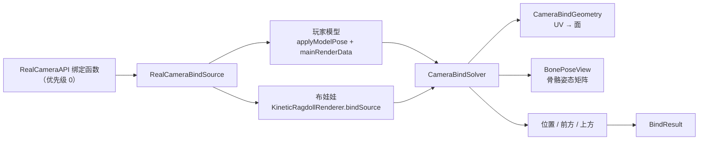

# 真实相机绑定

> **适用问题**：真实相机（Real Camera）如何得到相机的绑定位置与朝向、为什么由 KINETIC 侧解算、坐标系与缓存边界、性能与降级；**不包含**：真实相机自身的相机接管与裁剪逻辑，也不重新定义联动业务范围（见[相机绑定决策](../../product-decisions/decisions/camera-binding.md)）。

接入点与可选降级总则见[游戏与扩展接入](README.md)。本页只描述当前机制。

## 绑定是什么

真实相机的配置是一组**绑定目标**，每个目标给出三个归一化 UV 点与一个贴图前缀：

| 字段 | 含义 |
|---|---|
| `posU/posV` | 相机要待的那个点（例如头骨正面、眼睛高度处） |
| `forwardU/forwardV` | 落在某个面上，取该面的法线作为「前方」 |
| `upwardU/upwardV` | 同上，作为「上方」 |
| `textureId` | 该目标适用的贴图前缀，用来在多个目标间筛选 |

一次绑定输出「模型上的一个点 + 两个朝向」，真实相机再按自己的偏移配置与平滑把它变成相机位姿。内置默认目标落在头骨正面与头顶，解出来就是眼睛位置。

## 为什么由 KINETIC 解算

真实相机自带一份 KINETIC 兼容，做法是每帧把相机实体**离屏重画 4~8 遍**、用捕获顶点的 `MultiBufferSource` 接住顶点，再在顶点缓冲里按 UV 多边形反查图元。这条路径有三个结构性问题：

- **贵**：每帧多出 4~8 次模型烘焙与提交，与玩家数量无关地叠加在真实相机上；
- **上下文不对**：这些重画发生在 `Camera#setup` 之前，此时关卡渲染尚未开始，KINETIC 的渲染上下文与正常帧不一致；
- **脆**：只要 KINETIC 那一遍渲染因为任何原因没有产出几何（模型正在切换、原生状态未就绪、贴图未知），捕获到的顶点数就是 0，绑定判失败；对方在连续失败若干帧后会把整个模组关掉。

KINETIC 的模型是自己烘焙的，几何与骨骼姿态就在手边，不需要「画出来再读回来」。因此改为直接解算。

## 解算链路

| 组件 | 职责 |
|---|---|
| `RealCameraBindingInner` | 与真实相机 API 的唯一接触面：注册绑定函数、遍历目标、装配 `BindResult` |
| `RealCameraBindSource` | 判定这一帧按谁的模型绑定，并给出「解算器 + 骨骼姿态 + 姿态矩阵 + 贴图」 |
| `CameraBindSolver` | 把一组绑定 UV 解析成面（缓存），并按当前骨骼姿态求值 |
| `CameraBindGeometry` | 从原生烘焙模型抽出「UV → 面」索引表，提供面内插值与面法线 |
| `BonePoseView` | 原生烘焙产出的逐骨骼位置/法线矩阵（既有设施） |

`CameraBindGeometry` 只在某个目标第一次需要解析时抽取一次，并按模型实例缓存；此后逐帧只剩几次矩阵乘法。缓存键是弱引用的 `GeoModel`，模型卸载后表项自行消失，不会吊住原生资源。

## 坐标系

解算在**模型局部空间**完成，再乘上姿态矩阵：

- 位置：`模型姿态 · 骨骼姿态 · 面内插值点`
- 朝向：`模型法线姿态 · 骨骼法线姿态 · 面法线`

模型姿态与绘制共用同一份实现（`GeoReplacedEntityRenderer#applyModelPose`），因此绑定位置与画出来的模型严格重合；这也是为什么姿态不能被复制成第二份代码。

绘制侧同时把两个事实就地发布到 `GeoRenderData`，本层只读它们，不再自行推导：

| 字段 | 为什么需要 |
|---|---|
| `renderedTexture` | 本帧**实际**画出来的贴图（已过 `SpecialPlayerRenderEvent` 覆盖链）。`GeoRenderData.texture` 是能力自身贴图（内置 Steve/Alex 模型自带 `gsl.png` / `tartaric_acid.png`），拿它去匹配 `minecraft:textures/entity/player/...` 永远匹配不上，皮肤类模组也会被绕过 |
| `modelState`（既有） | 本帧 `levelImmutable()` 上下文烘焙出的几何与逐骨骼姿态；`AnimationParallelTicker` 每帧都会刷新它，因此不依赖该实体本帧是否真的被画出来 |

两条来源的目标空间不同：

- **玩家**：模型画在实体局部空间，结果直接就是实体局部坐标，真实相机自己会加上实体位置；
- **布娃娃**：尸体画在**世界**空间，因此结果要先减掉真实相机将要加回去的那个「相机实体插值位置」，两个公式必须逐字一致。

## 两条来源

| 情形 | 使用的模型 | 理由 |
|---|---|---|
| 本地玩家存活 | 玩家自身的 KINETIC 模型 | 与显示完全一致 |
| 本地玩家死亡、且 Ragdollified 正用 KINETIC 模型绘制尸体 | 该布娃娃 | 玩家模型已被提供方从渲染里摘掉，继续绑玩家必然失败；改绑尸体既保住死亡视角，也避免真实相机自我关闭 |

布娃娃来源通过 `RealCameraBindSource#setRagdollProvider` 注入，由 Ragdollified 兼容层在运行时初始化时装配。这样没装 Ragdollified 时不会加载到它的任何类型；没装真实相机时该回调永远不会被调用。

## 性能与降级

- **零额外绘制**：本层不提交任何几何，也不触发任何原生烘焙。对方自带的顶点捕获路径在本层给出结果后完全不会执行（优先级 `0` 高于它的 `-100`）。
- **一次性成本**：每个模型一次 UV 索引表抽取（每骨骼每分区一次 JNI 查询），此后按目标缓存解析结果。
- **失败即让位**：模型未加载、未烘焙、贴图未知、三个 UV 中任意一个在模型上找不到面、法线退化——任何一种都返回空结果，真实相机照常走它自己的兜底路径。本层只可能让绑定更快更准，不会让它消失。
- **可关闭**：`RealCamera.ModelBinding` 关闭后本层不注册结果，行为与没有本层时完全一致；`RealCamera.DeathRagdollBinding` 单独控制死亡后的来源切换。
- 找不到面时会按「贴图 + 模型」记一次日志，避免用户只看到一个没有解释的绑定失败。

离线复核与示意图由 `analysis/realcamera_bind_preview.py` 生成（`analysis/out/realcamera/bind-point.png`）：它按 `GeoBuilder` 的约定独立重建头部立方体，再按本页算法解一遍默认目标，并与 Java 侧 `CameraBindGeometryNativeTest` 的断言逐项比对；不一致就直接报错退出，因此这张图不会和真实实现悄悄分叉。

## 与死亡相机的关系

Ragdollified 自带死亡相机（把相机挂到尸体头部）在自己的 `ViewportEvent.ComputeCameraAngles` 里写入位置与角度，该事件晚于 `Camera#setup`，因此**同时开启时以提供方为准**，两者不会打架。本层的作用是在提供方关掉死亡相机、或玩家模型已被摘掉时仍然给出一份由模型真实眼睛位置驱动的绑定。

绘制侧另有一条与之配套的约束：当本地相机正处在这具尸体的脑袋里时，强制启用背面裁剪，否则看到的是自己头骨的内壁。见[布娃娃身体接管](ragdoll.md#死亡相机与绑定)。
