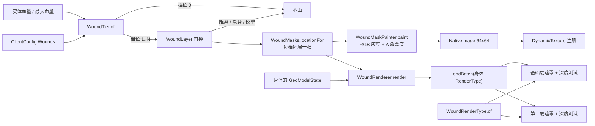

# 受伤外观叠加层

> **适用问题**：按血量叠加在玩家模型上的伤口如何算档位、如何生成两层遮罩、如何用深度缓冲裁决"贴外层还是内层"，以及它在布娃娃与第一人称手臂上的接法；**不包含**：产品承诺（见 [player-wound-overlay](../../product-decisions/decisions/player-wound-overlay.md)）、外部受伤外观模组的行为、动画与骨骼语义。

本页描述当前实现。产品义务与例外以[决策包](../../product-decisions/decisions/player-wound-overlay.md)为准；当前支持与验证缺口见[渲染已知问题](../../status/known-issues/rendering.md#受伤外观)。

## 责任边界

| 参与方 | 当前所有权与职责 | 不拥有 |
|---|---|---|
| `WoundTier` | 把（当前血量，最大血量，档位数）映射成整数档位；纯函数、无状态 | 配置来源、绘制时机 |
| `WoundMaskPainter` | 在 64×64 原版皮肤布局上程序化生成某一层、某一档位的伤口遮罩；纯函数、确定性 | GL 资源、颜色 |
| `WoundMasks` | 每个（档位，层）一张 `DynamicTexture` 的按需生成、注册与失效 | 何时画、画在哪 |
| `WoundFeature` | 开关、配置解析、与专门模组的互斥、模型适用范围 | 绘制 |
| `WoundRenderType` | 叠加层专用的 RenderType（混合 + alpha 裁剪 + 写深度 + 不排序），深度测试分 `EQUAL` / `LEQUAL` 两档，按 (贴图, 深度档) 缓存 | 门控、档位、遮罩内容 |
| `WoundRenderer` | 复用身体的 `GeoModelState`，按层提交两遍 | 门控、档位 |
| `WoundLayer` | 玩家模型上的门控与调用点 | 遮罩内容 |
| 布娃娃 / 第一人称手臂 | 各自的调用点与身体渲染类型 | 档位与遮罩 |

## 数据流

## 档位

`WoundTier.of(health, maxHealth, tiers)` 是纯函数，每帧现算，不缓存上一次结果——回血、金苹果与重生都必须立刻反映，任何迟滞或渐变都会让伤口和玩家看到的血量对不上。

实现上先把血量**向上取整成整点**再做整数除法：直接算 `(1 - hp/max) * tiers` 会在边界上抖（`1 - 0.8` 在双精度下是 `0.19999999999999996`，乘 5 之后落在 1.0 的哪一侧不确定），同一血量可能一帧一档来回跳，看起来就是伤口闪。量化还顺带满足了"伤口不要过度"：20 点血配 5 档时，掉 1~3 点仍是一档，掉满 4 点才升一档，零星擦伤不会让玩家身上立刻开花。

档位数被收敛到 2..10。拿不到最大血量（实体刚生成、能力未同步）时返回 0 档——宁可不画，也不要用猜出来的上限糊一身伤口。

## 遮罩

遮罩是**程序生成**的，不带任何贴图素材。这既是许可要求（现成的受伤外观素材是 GPL-3.0，KINETIC 是 Apache-2.0），也让形状、位置、数量都能在离线单测里断言，不会出现"素材里多了一个像素"这种只能靠眼睛发现的问题。

**每个像素是"灰度 + 不透明度"两个量。** 灰度乘顶点色得到这一点的血色深浅（越接近 0 越黑，对应弹孔中心、撕裂核心与碳灰；越接近 255 越接近纯血色，对应渗血外圈）；alpha 是这一点盖住皮肤多少。渲染时开启混合，GPU 得到 `皮肤·(1-A) + 血色·灰度/255·A`，也就是按 A 把血色混进皮肤。**渐变与半透明层全部来自这里**——没有 alpha 就只能是非黑即白的裁剪，也就是"贴纸"观感。

- 分辨率固定 64×64，与原版皮肤布局一致。做成 128/256 会让伤口比皮肤本身细 2~4 倍，而方盒模型在远处本来就靠贴图自身的纹素混叠，遮罩比它更细只会闪得更厉害。HD 皮肤是 64×64 布局的整数倍放大、UV 按比例对应，所以一张遮罩同时适配 64/128/256。
- 只画在原版布局的**身体部位**上。手臂区域取**宽手臂与细手臂的交集**（右臂 x=40..54、左臂 x=32..46）：细手臂的贴图比宽手臂窄 2 列，多出来的列在细皮肤上是全透明的，取并集就会在细手臂上落到透明区。
- 形状只有三种**小**尺寸：**刀伤**（3~7 格、会拐弯、宽度逐格变化的裂缝，外面裹一圈更淡的渗血）、**弹孔**（近黑核心 + 暗红外圈 + 低透明度血雾，约 3×3）、**小血点**（约 2×2，带一圈更淡的渗血）。每一层轮廓半径都逐像素抖动，所以边缘不平整。另有**飞溅**（伤口周围散落的单像素血点）与**碳灰**（近处贴着伤口的烧灼、远处飞散的火药灰；透明度压得很低，于是在浅色皮肤上表现为灰色斑点而不是一层红）。
- **没有"大块撕裂"。** 试过用一块半径 3 格以上的血泊制造冲击力，结果是那块血泊把整个躯干吃掉了：一处伤口盖住三分之一的前胸，剩下的地方没有余地再放细碎的刀伤与血点，手臂上也几乎分不到。参考实现对玩家只用 2×2 与 3×3 的小素材，靠"数量多、分布均匀、中心深边缘浅"堆出重伤观感。所以冲击力来自**数量与对比度**，不来自单块面积；`noSingleWoundIsLarge` 单测把单处面积上限钉死。
- 每处伤口**裁剪在它所属部位的贴图矩形内**。相邻部位（例如左腿背面与左臂外侧）的贴图是挨着的，不裁剪的话一处伤口的基础层副本落在腿上、第二层副本却按手臂的偏移落到了袖子上，两层就不再是"同一个矩形加一个平移"。
- 种子与档位无关：第 t 档恒为同一串伤口的**前 count(t) 处**。于是升档只是往上加伤口，回血只是少掉最新那批，已有伤口的位置与形状都不变——视觉上是"伤口在愈合"，而不是"整身重新随机了一遍"。这与 Visual Health 的增量盖印是同一个行为。

### 两层与深度裁决

原版皮肤的第二层（帽子、外套、袖子、裤子）与基础层是同一批方盒、向外偏移 0.25 像素。渲染分两遍，各用一张只含本层区域的遮罩：

1. **基础层那一遍**画基础层遮罩；
2. **第二层那一遍**画第二层遮罩。

第二层那一遍用**深度相等测试**（`EQUAL`）。身体那一遍先画，只有皮肤不透明（cutout 阈值 0.1）的像素才会写深度；第二层皮肤不透明时，那个位置留下的正是第二层几何的深度，相等测试通过；第二层皮肤透明时，那里留下的是基础层的深度，与第二层的位置不等，这一遍整片被丢掉。基础层那一遍画在被第二层挡住的地方之外。

于是"外层皮肤存在就贴在外层、不存在才贴在内层"完全由深度缓冲裁决：**不需要知道玩家用的是哪张皮肤，也不会有一层血浮在半空**。两张遮罩因此都按全强度绘制——内层那一份在外层存在时是被不透明几何整个遮住的，不是混合掉的，所以不需要减淡。

身体走透明渲染类型（`ForceCutoutRenderer=false`）时它**不写深度**，相等测试会把所有像素都判掉，所以那种配置下退回 `LEQUAL`：血照常画在身体上，代价是外层透明时那层血会浮着——这是"身体不提供深度"的必然结果，也是这一档唯一的降级。

**每一处伤口在两层上都画一份**，且两层严格是同一个矩形加一个平移（见上面"裁剪在所属部位矩形内"）。这条性质由 `overlayMaskMirrorsTheBaseMaskExactly` 单测钉死：只要有一层少画了，就会出现"外层皮肤在、但那一层没有血"的空洞。

### 数值与平衡

伤口数量按档位累加：每档新增 `22 × 密度% × 5/档位数`，默认 5 档、50% 密度时累计 11/22/33/44/55 处。因为形状都小，重伤观感完全靠数量堆出来——这也是密度必须对着参考实现标定的原因。

- **密度对着 Visual Health 标定。** `analysis/wound_vh_reference.py` 用 VH 自己的算法（8×8 格洗牌、格心 + `nextInt(17)-8` 抖动、generic 素材、0.30~0.50 不透明度）在同一张皮肤上跑出 215/381/590/727/892 个盖印像素；KINETIC 两层合计 148/342/462/628/760。真正显示出来的像素还要过一遍"外层皮肤在不在"的裁决，`analysis/wound_preview.py` 按同一规则统计：KINETIC 74/171/231/314/380 对 VH 82/159/249/336/423。
- **头部单独压一档。** 头面积小、又是辨认对方的第一眼，同样密度下会比躯干糊得多。所以头部部位权重减半（脸 1、其余 2）、伤口尺寸乘 0.75、血痕概率从 55% 降到 30%。目标是"看得出挨了打"而不是"看不出是谁"。

### 为什么遍历范围必须固定

`blob` 的遍历范围是常量 `BLOB_EXTENT`，不随半径变化。每个候选像素都要消耗一次 `nextFloat()` 取轮廓抖动；如果范围跟着半径走，"半径变了"就会改变随机数的消耗数量，整条伤口序列随之分叉，`higherTierContainsEveryLowerTierWound` 与 `overlayMaskMirrorsTheBaseMaskExactly` 两条性质同时失效。

更一般地，**任何会改变循环次数的档位依赖都是禁止的**：形状选择、尺寸、血痕长度都必须只依赖部位与随机掷点，不依赖档位；档位只决定"画几处"。现在整条几何都与档位无关，这条约束自然满足——但它是被违反过一次才被写下来的（血痕长度曾经乘过档位系数），所以 `higherTierContainsEveryLowerTierWound` 必须一直留着。

## 纹理生命周期

每个（档位，层）一张 `DynamicTexture`，第一次真正用到时才生成（4096 个像素），整局缓存。缓存键包含生成时的档位数与密度：只按档位缓存的话，玩家改了配置之后旧遮罩会一直留在显存里，画出来的数量和配置对不上。

`DynamicTexture` 继承的 `AbstractTexture#reset` 只是把自己重新注册回 `TextureManager`，内容不来自任何资源包，因此资源重载后仍然有效，不需要额外的清理钩子。

## 提交

叠加层**复用身体已经提取好的 `GeoModelState`**，只是换遮罩再提交。另一条路是按 (皮肤, 档位) 合成新贴图，那要为每个玩家、每个档位各生成并上传一张；16 个玩家就是 16 张起步。玩家模型本来只有两三千个顶点，多提交两遍远小于一次贴图生成加 GL 上传。

伤口与身体落在**完全相同**的深度上，所以「谁后画谁赢」。同族 RenderType 的入队顺序能保证身体在前，但 `renderLayersFirst` 的模型会先跑叠加层、那时身体还没入队。因此 `WoundRenderer` 在提交自己之前显式 `endBatch` 一次身体那一批，顺序与模型配置无关——也正因为身体已经画完，叠加层才能用「混合 + 写深度 + 不排序」的 `WoundRenderType`，不必为排序付代价。

身体的渲染类型由 `GeoReplacedEntityRenderer` 算完后就地发布到 `GeoRenderData.bodyRenderType`。叠加层若自己再推一遍这个类型，只要有一项判断不一致（例如皮肤链给了贴图覆盖），刷批就会落空；同一份值也用来判断身体有没有写深度（`bodyRenderType instanceof CustomTranslucentRenderType`）。

血色通过 `NativeRenderer.render` 的颜色参数给到顶点色，与灰度遮罩相乘。因此所有玩家共用同一套遮罩，血色仍然可以逐玩家不同。

## 门控

`WoundLayer` 按"便宜到贵"排序，远处和满血的玩家在算模型身份之前就被排除：

1. 特性开关与互斥（存在专门实现该外观的模组时整体关闭）；
2. 档位为 0（满血）——这是绝大多数玩家的绝大多数时间；
3. 超出绘制距离（默认 48 格）；
4. 隐身（隐身玩家身上浮着伤口会直接暴露位置）；
5. 模型身份（最贵的一步：要查目录）。默认只接受内置宽/细手臂模型，跳过时记一次日志说明如何开启。

## 布娃娃

布娃娃是尸体，血量归零，因此按最高档绘制。玩家实体在死亡后会被移除，模型身份也只在建立布娃娃状态时可得，所以身份随死亡姿态一并保存到 `KineticRagdollState`。

布娃娃的**绘制距离与快照保留时长都跟随 Ragdollified 的配置**，KINETIC 不再自己定义一套；理由见[布娃娃身体接管](../integration/ragdoll.md#绘制距离与快照保留)。

## 第一人称手臂

手臂模型用的是同一套原版皮肤 UV，所以同一张遮罩直接对得上，`CustomFirstPersonArmRenderer` 里的接法与玩家模型一致（同样是先刷身体那一批）。手臂走的是透明渲染类型，因此那一遍用 `LEQUAL` 而不是 `EQUAL`。

**注意：这条路径当前是死代码。** 第一人称手臂的 KINETIC 模型渲染入口（`ReplacePlayerHandRenderEvent` / `ReplacePlayerArmRender`）在仓库里是整段注释掉的 TODO，游戏内第一人称显示的是原版手臂。接好伤口只是在入口恢复时不必再改一次，不代表第一人称已经能看到伤口。
